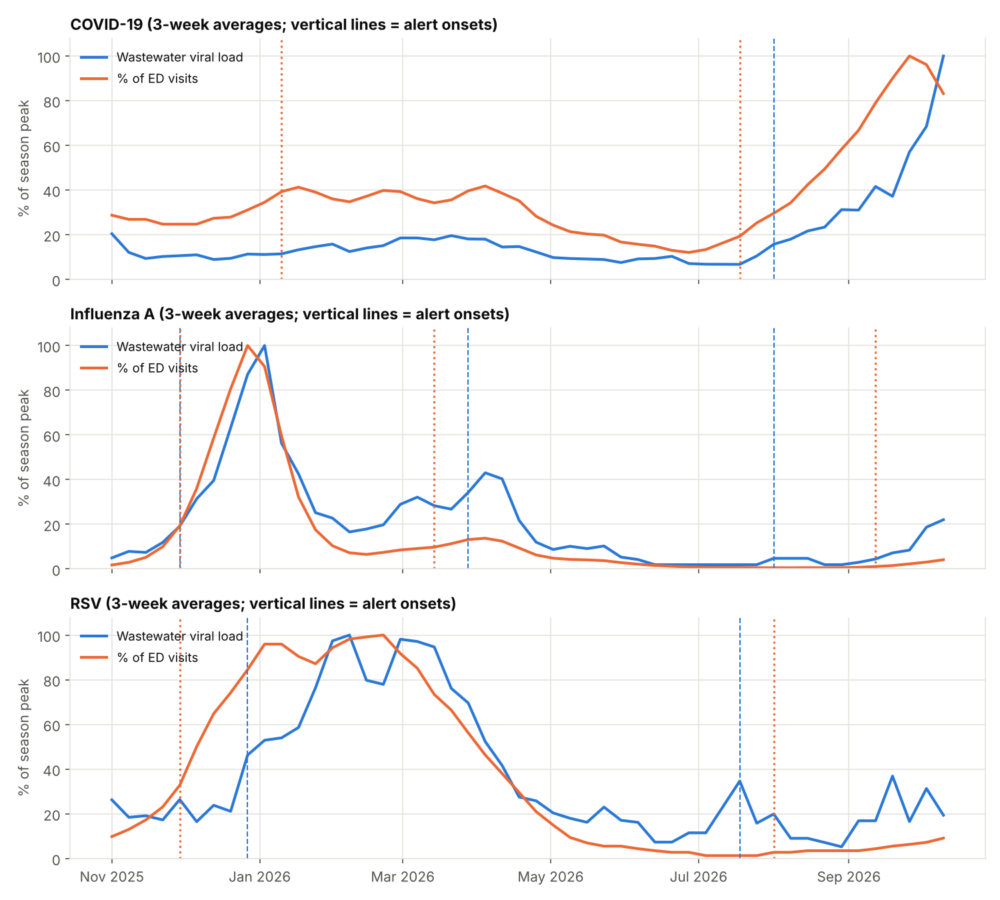
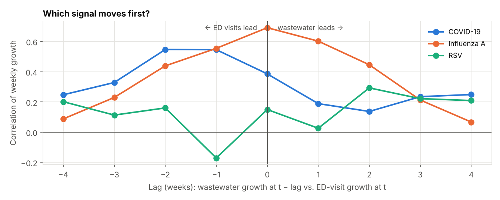

# NYC Wastewater Early-Warning System

Wastewater surveillance tracks virus levels in sewage. The promise is that it shows outbreaks *before* people show up at hospitals, because infected people shed virus before they feel sick enough to seek care.

This project builds an early-warning system on **New York City Health Department data** for **COVID-19, influenza A and RSV**, then tests that promise honestly. Does wastewater actually move first in NYC?

## Current status (week ending Oct 10, 2026)

| Pathogen | Status | Week-over-week | vs. past year | % of ED visits |
|---|---|---|---|---|
| COVID-19 | **HIGH – rising fast** | +46% | 98th percentile | 0.44% |
| Influenza A | **HIGH – rising fast** | +18% | 65th percentile | 0.39% |
| RSV | falling | −38% | 41st percentile | 0.04% |

The status refreshes every Thursday when NYC publishes new data: `python run.py --refresh`.



## What the data shows

**In NYC's 2025–26 season, citywide wastewater moved *with* emergency department visits, not ahead of them.**

| Pathogen | Best-matching lag | Correlation at that lag | Wave-onset timing |
|---|---|---|---|
| COVID-19 | ED visits led by ~2 weeks | 0.55 | Summer 2026 wave: ED alert 2 weeks before wastewater |
| Influenza A | Same week | 0.69 | Winter wave: both alerted the same week (Nov 29) |
| RSV | Wastewater led by ~2 weeks (weak) | 0.29 | Mixed: wastewater 4 weeks *later* in winter, 2 weeks earlier in summer |



Adding wastewater to a next-week ED forecast did **not** beat simply carrying last week's value forward (walk-forward test, 28 weeks).

### Why this isn't a failure

This is a real, useful result, and it matches what health departments report about *citywide, weekly* wastewater data:

- **Weekly averages blur a lead of a few days.** Studies that report a wastewater lead usually measure it in days, not weeks. At weekly resolution that shows up as "same week."
- **Citywide averaging hides local signals.** NYC has 14 treatment plants; a rise in one borough is diluted in the city average.
- **NYC's ED surveillance is already fast.** ED visit data is reported by visit date, so there's little reporting delay for wastewater to beat.
- **One season is a small sample.** It covers one COVID wave, one flu season and one RSV season.

Where wastewater clearly adds value is **independence from care-seeking**. It counts infections in people who never see a doctor or test at home, so it stays informative as clinical testing declines.

## How the system works

1. **Load** NYC Health's weekly wastewater viral loads and ED-visit percentages (pulled directly from their GitHub, so it updates itself). Values below the lab's detection limit are substituted with half the lowest detected value and flagged.
2. **Smooth** with a trailing 3-week geometric mean. Wastewater is log-normal and spiky, so averaging happens in log space.
3. **Alert** when the smoothed signal reaches 2× its lowest point in the previous 8 weeks, meaning a wave is taking off. The same rule is applied to ED visits (1.5×) to date clinical waves.
4. **Measure timing** two ways: correlation of *weekly growth rates* at different lags (avoiding the inflated correlations trending series give), and onset-to-onset lead time.
5. **Test forecasting value** with a walk-forward comparison: an ED-history-only model vs. the same model plus wastewater, refit each week on past data only.

Every step uses only data available at that point in time, so there's no look-ahead.

## Extending to five years of COVID data

NYC also publishes **per-plant SARS-CoV-2 wastewater data back to 2020** on NYC Open Data, and daily COVID hospitalizations to Oct 2025 are already included. To run the multi-wave analysis:

1. Download the CSV: https://data.cityofnewyork.us/d/f7dc-2q9f → Export → CSV
2. Save it as `data/raw/nyc_wastewater_by_plant.csv`
3. Run `python run.py`. The loader builds a population-weighted citywide signal from the 14 plants and adds a lead-lag and forecast analysis against weekly hospitalizations.

## Run it

```bash
pip install -r requirements.txt
python run.py            # uses the data snapshot in data/raw
python run.py --refresh  # downloads this week's release first
pytest                   # 5 tests incl. recovering a known 2-week lead from synthetic data
```

## Data sources

All data is from the NYC Department of Health and Mental Hygiene and is public:

- [nychealth/respiratory-illness-data](https://github.com/nychealth/respiratory-illness-data): weekly citywide wastewater viral load (SARS-CoV-2, flu A, flu B, RSV) and weekly ED visits by pathogen.
- [nychealth/coronavirus-data](https://github.com/nychealth/coronavirus-data): daily COVID-19 hospitalizations, 2020–2025.
- [NYC Open Data f7dc-2q9f](https://data.cityofnewyork.us/d/f7dc-2q9f): SARS-CoV-2 concentration by wastewater treatment plant (optional).

The snapshot in `data/raw/` is from the October 15, 2026 release.

## Project structure

```
├── ews/
│   ├── data.py      # download + tidy NYC data, below-detection handling, per-plant loader
│   ├── signals.py   # smoothing, growth, alert rule, onset matching, lead-lag, status
│   └── forecast.py  # walk-forward forecast test
├── run.py           # weekly report → results/ + images/
├── data/raw/
├── results/
├── images/
└── tests/
```

## Tools

Python · pandas · NumPy · scikit-learn · Matplotlib · pytest
